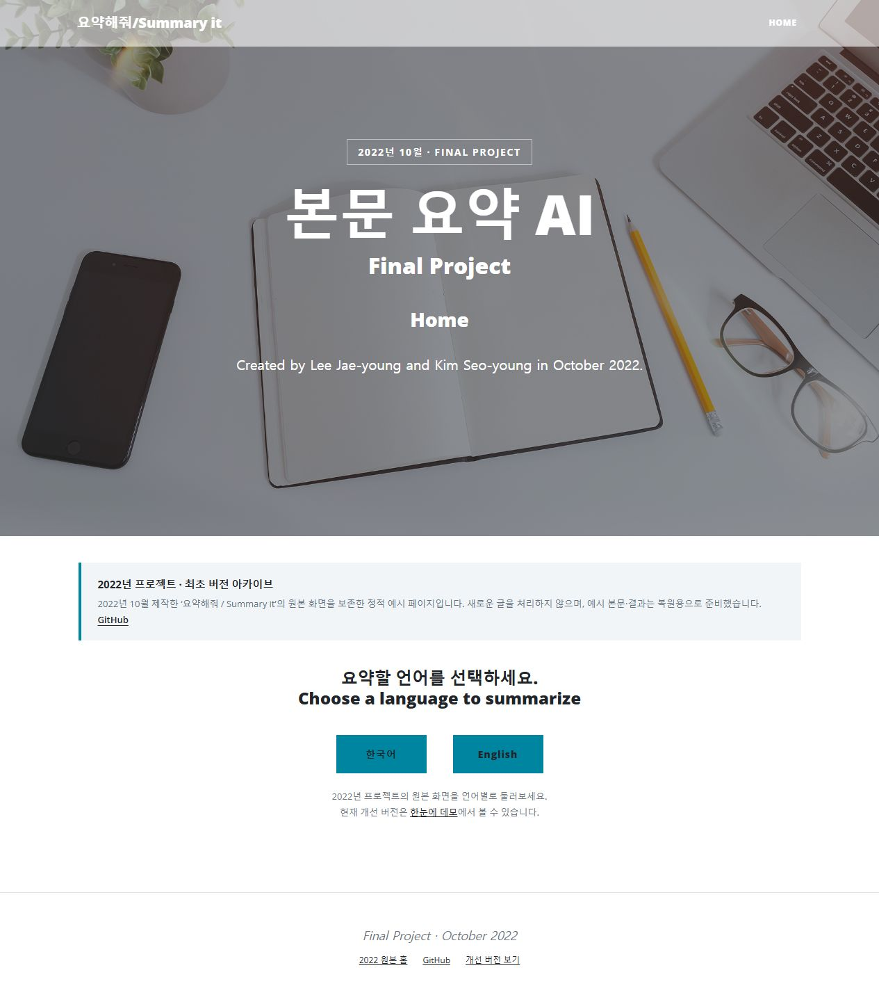
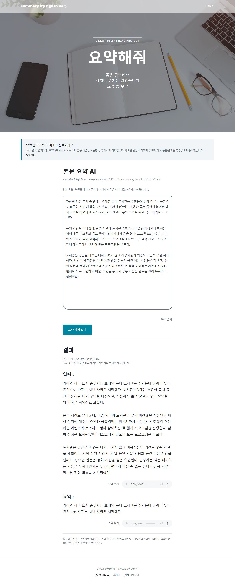

<p align="center"><strong>2022 · FINAL PROJECT · ORIGINAL UI ARCHIVE</strong></p>
<h1 align="center">요약해줘 / Summary it</h1>
<p align="center"><strong>2022년 10월에 제작한 한국어·영어 텍스트 요약 프로젝트</strong><br>최초 버전의 화면을 보존한 정적 예시 아카이브</p>
<p align="center">
  <a href="https://dlwo8520.github.io/summary-it-2022/"><strong>2022 원본 데모 보기 ↗</strong></a>
  &nbsp;·&nbsp;
  <a href="https://dlwo8520.github.io/summary-it-2022/kr.html">한국어</a>
  &nbsp;·&nbsp;
  <a href="https://dlwo8520.github.io/summary-it-2022/en.html">English</a>
  &nbsp;·&nbsp;
  <a href="https://github.com/dlwo8520/hannune-summary-demo">현재 개선 버전</a>
</p>



## 2022년에 만든 프로젝트입니다

이 저장소는 **2022년 10월에 진행한 ‘요약해줘 / Summary it’ 프로젝트의 최초 UI**를 보존합니다. 처음 제작했던 배경 이미지, Clean Blog 스타일, 한국어·영어 선택 화면, 언어별 입력·결과 페이지 구성을 유지했습니다.

원본 화면의 제작 표기도 그대로 보존했습니다.

> Created by Lee Jae-young and Kim Seo-young in October 2022.

**프로젝트 제작 시점은 2022년이며, 이 저장소는 현재 공개를 위해 복원한 아카이브입니다.** GitHub 업로드 날짜가 원래 프로젝트의 제작 날짜를 뜻하지 않습니다.

## 무엇을 볼 수 있나요?

| 페이지 | 내용 |
| --- | --- |
| [Home](https://dlwo8520.github.io/summary-it-2022/) | 2022 Final Project 소개와 언어 선택 |
| [한국어](https://dlwo8520.github.io/summary-it-2022/kr.html) | 원본 한국어 화면, 고정 원문과 KoBART 요약 예시 |
| [English](https://dlwo8520.github.io/summary-it-2022/en.html) | 원본 영어 화면, BART 요약과 고정 한국어 번역 예시 |

<details>
  <summary>한국어 페이지 미리보기</summary>
  <br>
  
</details>

### 고정 예시 안내

이 공개 페이지는 HTML·CSS·JavaScript·이미지·폰트만으로 동작합니다. 새 글 입력, 실시간 모델 추론, 번역 API, 음성 생성은 실행하지 않습니다. PC나 모델 서버를 켜둘 필요 없이 GitHub Pages에서 열 수 있습니다.

- 본문은 시연용으로 작성한 가상의 문서입니다.
- 요약은 기존 로컬 KoBART·BART 모델로 미리 생성한 결과이며, 모델 가중치를 새로 학습하거나 수정하지 않았습니다.
- **예시 데이터는 아카이브 복원을 위해 2026년 10월 19일에 준비한 것으로, 2022년 당시의 실제 입력·출력 기록은 아닙니다.**
- 영어 요약 아래의 한국어 번역은 화면 복원을 위해 직접 작성한 고정 예시입니다.
- 음성 컨트롤은 원본 기능의 위치를 보여줍니다. 정적 데모에는 음성 파일이 없으며 재생되지 않습니다.

## 보존 범위

| 그대로 보존한 것 | 정적 공개를 위해 조정한 것 |
| --- | --- |
| 원본 HTML 템플릿 3개와 테마 JavaScript를 `archive/`에 보관 | 공개 HTML의 Django 템플릿 태그를 고정 콘텐츠로 변환 |
| 원본 CSS, 배경 사진, 파비콘 | 상대 경로 수정과 모바일 가로 넘침 보완 |
| 프로젝트 이름·소개·제작자·2022년 10월 표기 | 모든 화면에 ‘2022년 프로젝트 · 최초 버전 아카이브’ 안내 |
| 한국어·영어 개별 페이지와 결과 순서 | POST·외부 CDN 제거, 서체를 저장소 내에서 제공 |

보존에 사용한 자료는 로컬 백업 `news_summery_original_20261016.zip`입니다. 백업 파일명은 보관 시점을 나타냅니다. 원본 UI 파일의 SHA-256은 [source-manifest.json](archive/source-manifest.json)에 기록했습니다. 데이터베이스, 모델, 토크나이저, 환경 변수, 인증 정보는 포함하지 않습니다.

## 로컬 실행

`docs/index.html`을 직접 열거나 Python 3가 설치된 환경에서 실행합니다.

```bash
python -m http.server 4174 --bind 127.0.0.1 --directory docs
```

브라우저에서 `http://127.0.0.1:4174`에 접속합니다. 패키지를 설치하거나 빌드할 필요가 없습니다.

### 예시를 수정할 때

[examples/fixed.json](examples/fixed.json)의 고정 문구를 수정한 뒤 HTML을 다시 생성합니다. 생성 스크립트는 Python 표준 라이브러리만 사용하며 네트워크나 모델에 접근하지 않습니다.

```bash
python scripts/build.py
python scripts/verify.py
```

## 무료 공개 설정

저장소 **Settings → Pages**에서 `Deploy from a branch` → `main` → `/docs`를 선택합니다. [GitHub Pages 공식 안내](https://docs.github.com/en/pages/getting-started-with-github-pages/configuring-a-publishing-source-for-your-github-pages-site)

## 파일 구성

```text
.
├── docs/                      # 공개되는 정적 페이지와 로컬 자산
│   ├── index.html
│   ├── kr.html
│   ├── en.html
│   └── assets/                # 원본 CSS·배경·아이콘 + 서체·보완 스타일
├── archive/
│   ├── templates/             # 백업에서 가져온 원본 템플릿 3개
│   ├── scripts.js             # 원본 테마 스크립트
│   └── source-manifest.json   # 원본 파일 해시
├── examples/fixed.json        # 복원용 고정 예시와 준비 시점
├── scripts/
│   ├── build.py               # 원본 템플릿 → 정적 페이지
│   └── verify.py              # 보존 무결성·경로·고정 페이지 검사
├── licenses/                  # 테마·프레임워크·서체 라이선스
└── .github/assets/            # README 미리보기
```

## 사용한 테마와 서체

원본은 Start Bootstrap **Clean Blog v6.0.8 / Bootstrap v5.1.3** 스타일을 사용합니다. Lora와 Open Sans 서체는 이 아카이브에서 로컬 파일로 제공합니다. 저작권·라이선스·출처는 [THIRD_PARTY_NOTICES.md](THIRD_PARTY_NOTICES.md)에 정리했습니다.

---

<p align="center"><strong>Originally made in October 2022.</strong><br>요약해줘 / Summary it · Final Project</p>
